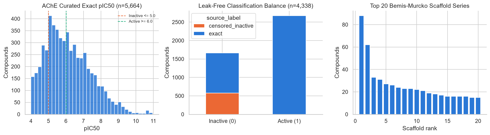
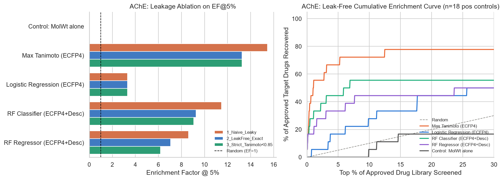

# Checkpoint 1 Summary — Project 7 (Drug Repurposing)

**Course:** Bioinformatics · Project 7 (*Repurposing approved drugs against one target*)  
**Date:** 2026-11-23 · **Data Release:** ChEMBL 37 (`ChEMBL_37`), Open Targets Platform (GraphQL v4), RCSB PDB  
**Reproducible Code & Notebooks:** [01_target_screening_and_dataset_check.ipynb](../notebooks/01_target_screening_and_dataset_check.ipynb) · [02_checkpoint1_baselines.ipynb](../notebooks/02_checkpoint1_baselines.ipynb)

---

## 1. Research Question (One Sentence)

> *For human acetylcholinesterase (**AChE**, `CHEMBL220`), which FDA/EMA-approved small-molecule drugs do ligand-based QSAR models rank as candidate binders—and does a leak-free ranking recover the approved AChE drugs near the top of the library?*

---

## 2. Target Selection & Live Proof on CDK2 / CDK9

We screened **all 11 targets from Slide 13** plus our initial candidates (**CDK2** and **CDK9**) live against ChEMBL 37, Open Targets Platform (`drugAndClinicalCandidates`), and RCSB PDB (`data/processed/target_screening_summary.csv`):

| Target | Source | ChEMBL ID | ChEMBL IC50 Records | ChEMBL Ki Records | ChEMBL Phase 4 MoA (SM) | Open Targets Approved (SM) | Positive Controls (Union) | Holo PDB Structures |
|---|---|---|---:|---:|---:|---:|---:|---:|
| **AChE (Selected)** | Slide 13 | `CHEMBL220` | **10,079** | 1,970 | 16 | 18 | **21** | **76** |
| SLC6A4 | Slide 13 | `CHEMBL228` | 5,130 | 4,678 | 25 | 25 | 28 | 31 |
| DRD2 | Slide 13 | `CHEMBL217` | 2,480 | 14,842 | 42 | 57 | 63 | 12 |
| ABL1 | Slide 13 | `CHEMBL1862` | 5,295 | 1,781 | 7 | 8 | 8 | 71 |
| BRAF | Slide 13 | `CHEMBL5145` | 11,017 | 47 | 5 | 6 | 6 | 127 |
| PARP1 | Slide 13 | `CHEMBL3105` | 4,993 | 1,212 | 2 | 6 | 6 | 102 |
| ADORA2A | Slide 13 | `CHEMBL251` | 3,050 | 9,055 | 2 | 5 | 5 | 190 |
| NTRK1 | Slide 13 | `CHEMBL2815` | 10,647 | 934 | 2 | 5 | 5 | 56 |
| NTRK2 / NTRK3 | Slide 13 | `CHEMBL4898` / `5608` | 924 / 556 | 957 / 704 | 1 / 1 | 4 / 4 | 4 / 4 | 6 / 4 |
| DHFR | Slide 13 | `CHEMBL202` | 1,590 | 512 | 3 | 3 | 3 | 88 |
| **CDK2 (Ruled out)** | Initial | `CHEMBL301` | 3,692 | 1,210 | **0** | **0** | **0** | 489 |
| **CDK9 (Ruled out)** | Initial | `CHEMBL3116` | 2,351 | 426 | **0** | **0** | **0** | 25 |

### Why We Switched from CDK2/CDK9 to **AChE (`CHEMBL220`)**
1. **Live proof on CDK2 & CDK9:** Both ChEMBL 37 (`mechanism.json`, `max_phase = 4`) and Open Targets (`ENSG00000123374` / `ENSG00000136807`, `APPROVAL / PHASE_4`) confirm **0 FDA/EMA-approved small-molecule drugs** with CDK2 or CDK9 as their primary mechanism of action (highest stage is Phase 3: dinaciclib, alvocidib). Without approved positive controls, Project 7's mandatory validation test cannot be evaluated cleanly.
2. **Why AChE wins:** **10,079 single-endpoint `IC50` records** (matching Slide 13 *"curated to pIC50"* without mixing `Ki`), **21 approved small-molecule positive controls** (18 unique curated organic small molecules after salt/connectivity deduplication), and **76 holo PDB co-crystal structures** (e.g., `4M0E`, `6NTO`, `5HF5`) for Week 3 structural interpretation / optional docking.
3. **Target Accessions & URLs:**
   - **ChEMBL:** `CHEMBL220` — `https://www.ebi.ac.uk/chembl/target_report_card/CHEMBL220/`
   - **UniProt:** `P22303` — `https://www.uniprot.org/uniprotkb/P22303`
   - **Open Targets:** `ENSG00000087085` — `https://platform.opentargets.org/target/ENSG00000087085`
   - **RCSB PDB (top resolution holo):** `4M0E`, `6NTO`, `5HF5` — `https://www.rcsb.org/`

---

## 3. Dataset Check Summary (Real Data)

### A. ChEMBL Bioactivity Curation Funnel (`ache_curation_funnel.csv`)
Reusing Assignment 5 Task A (`curate_activity`, salt stripping + charge neutralization + median aggregation + InChIKey14 matching):

| Step | Count | Notes |
|---|---:|---|
| Raw ChEMBL binding (`assay_type = B`) `IC50` records | 9,882 | Single endpoint (`IC50` only; no `Ki` mixing) |
| After `data_validity_comment is None` | 9,253 | Dropped 629 flagged dubious records |
| Exact relation (`standard_relation == '='`) + valid molar units (`nM/uM/M`) + valid RDKit SMILES | 7,192 | Dropped 1,993 censored (`>`, `<`), 67 non-molar, 1 invalid SMILES |
| **Unique curated compounds (Exact `pIC50` regression)** | **5,664** | 570 compounds with >1 replicate; **47 compounds disagree by >2.0 log units** (median protects against unit errors) |
| Exact Actives (`pIC50 >= 6.0`, IC50 <= 1 µM) | 2,799 | Before InChIKey14 dedup |
| Exact Inactives (`pIC50 <= 5.0`, IC50 >= 10 µM) | 1,114 | Dropped 1,751 ambiguous grey-zone (`5–6`) compounds |
| Rescued censored inactives (`>`, `>=` at >= 10,000 nM) | **+585** | Real experimental negatives with guaranteed `pIC50 <= 5.0` |
| **Final Classification Dataset (naive)** | **4,366** | **2,692 actives (61.7%) / 1,674 inactives (38.3%)** |

### B. Approved Small-Molecule Library & Leakage Audit (`ache_leakage_summary.csv`)
- **Open-access library:** ChEMBL `max_phase == 4`, `molecule_type == 'Small molecule'` (`3,475` raw records → **`2,027` unique organic drug-like small molecules** after salt stripping, organic-element filter, `100 <= MW <= 900 Da`, `heavy_atoms >= 6`, and `InChIKey14` deduplication).
- **Positive controls matched in curated library:** **`18 / 21`** unique approved drugs (donepezil, rivastigmine, galantamine, benzgalantamine, tacrine, physostigmine, neostigmine, pyridostigmine, distigmine, demecarium, ambenonium, edrophonium, minaprine, hexafluorenium, propanidid, isoflurophate, echothiophate, pralidoxime).
- **Critical Leakage Finding:**
  - **`14 / 18` positive controls (78%)** appeared inside the raw ChEMBL regression set (**51 total approved drugs** overlapped).
  - **`7 / 18` positive controls (39%)** appeared inside the raw ChEMBL classification set (**28 total approved drugs** overlapped).
  - After exact `InChIKey14` removal: **5,613** leak-free regression compounds (**5,610** at strict `Tanimoto < 0.85`) and **4,338** leak-free classification compounds spanning **2,095 distinct Bemis–Murcko scaffolds** (**4,337** at strict `Tanimoto < 0.85`).

---

## 4. Baseline Methods & First Numbers (5 Seeds, Mean ± Std)

### A. Internal Held-Out Validation (Random Split vs. Bemis–Murcko Scaffold Split — Leak-Free Data)

| Formulation | Model | Random Split | Bemis–Murcko Scaffold Split | Key Takeaway |
|---|---|---|---|---|
| Classification | Max Tanimoto (ECFP4) | ROC `0.900 ± 0.008` · PR `0.926 ± 0.006` | **ROC `0.844` · PR `0.895`** | Strong similarity baseline; drops -0.056 on unseen scaffolds |
| Classification | Logistic Regression (ECFP4) | ROC `0.935 ± 0.004` · PR `0.955 ± 0.005` | **ROC `0.862` · PR `0.909`** | Linear baseline beats Tanimoto internally |
| Classification | RF Classifier (ECFP4+Desc) | ROC `0.960 ± 0.006` · PR `0.974 ± 0.006` | **ROC `0.900 ± 0.002` · PR `0.938 ± 0.002`** | Best internal classifier |
| Regression (`pIC50`) | RF Regressor (ECFP4) | $R^2$ `0.705 ± 0.020` · MAE `0.511` | **$R^2$ `0.462 ± 0.002` · MAE `0.777`** | Substantial drop on novel scaffolds |
| Regression (`pIC50`) | RF Regressor (RDKit Desc) | $R^2$ `0.526 ± 0.011` · MAE `0.672` | **$R^2$ `0.275 ± 0.003` · MAE `0.914`** | Physicochemical descriptors alone underperform ECFP4 |
| Regression (`pIC50`) | RF Regressor (ECFP4+Desc) | $R^2$ `0.713 ± 0.020` · MAE `0.507` | **$R^2$ `0.488 ± 0.003` · MAE `0.762`** | Combining ECFP4 + descriptors beats either alone |

### B. Approved-Drug Ranking: **Leak-Free (Exact)** Primary Results (`n = 2,027` drugs, `18` positive controls)

| Formulation | Method | ROC-AUC | PR-AUC | EF@1% | EF@5% | BEDROC20 | Median Rank | % in Top 5% |
|---|---|---:|---:|---:|---:|---:|---:|---:|
| Control | **MolWt alone** | 0.378 | 0.007 | **0.00** | **0.00** | 0.018 | 1,440.0 | 0.0% |
| Classification | **Max Tanimoto (ECFP4)** | **0.847** | **0.467** | **48.26** | **13.25** | **0.654** | **21.0** | **66.7%** |
| Classification | Logistic Regression (ECFP4) | 0.654 | 0.021 | 5.36 | 3.31 | 0.149 | 635.0 | 16.7% |
| Classification | **RF Classifier (ECFP4+Desc)** | 0.631 | 0.247 | 27.88 ± 2.14 | **9.27 ± 1.13** | 0.426 ± 0.034 | 154.5 | **46.7%** |
| Regression | RF Regressor (ECFP4) | 0.540 | 0.133 | 16.09 ± 0.00 | 3.53 ± 0.44 | 0.198 ± 0.004 | 812.8 | 17.8% |
| Regression | RF Regressor (RDKit Desc) | 0.589 | 0.032 | 5.36 ± 0.00 | 4.42 ± 0.00 | 0.178 ± 0.007 | 700.2 | 22.2% |
| Regression | **RF Regressor (ECFP4+Desc)** | 0.613 | 0.200 | 19.30 ± 2.63 | **7.07 ± 0.88** | 0.322 ± 0.026 | 522.9 | **35.6%** |

### C. Quantified Leakage Inflation (3-Tier Ablation on `EF@5%` / `BEDROC20`)

| Method | 1. Naive (Leaky) | 2. Leak-Free (Exact) | 3. Strict (`Tanimoto < 0.85`) | Inflation Observed |
|---|---:|---:|---:|---|
| Max Tanimoto (ECFP4) | EF@5% `15.46` · BEDROC `0.723` | EF@5% `13.25` · BEDROC `0.654` | EF@5% `13.25` · BEDROC `0.651` | +2.21 EF@5% / +0.070 BEDROC from exact leakage |
| RF Classifier (ECFP4+Desc) | EF@5% `11.48` · BEDROC `0.546` | EF@5% `9.27` · BEDROC `0.426` | EF@5% `9.05` · BEDROC `0.420` | +2.21 EF@5% / +0.120 BEDROC from exact leakage |
| RF Regressor (ECFP4+Desc) | EF@5% `8.61` · BEDROC `0.392` | EF@5% `7.07` · BEDROC `0.322` | EF@5% `6.18` · BEDROC `0.291` | +2.43 EF@5% / +0.101 BEDROC (14/18 pos controls leaked!) |

### D. Key Early Interpretations (Ready for Checkpoint 1 Q&A)
1. **No size bias:** `MolWt` alone scores `EF@5% = 0.00` and `ROC-AUC = 0.378`, proving enrichment comes from genuine pharmacophoric signal.
2. **Classification outperforms regression on approved-drug enrichment:** Rescuing `+585` censored experimental inactives (`IC50 > 10 µM`) gave the classifier sharper negative decision boundaries (`RF Classifier EF@5% = 9.27` vs. `RF Regressor EF@5% = 7.07`).
3. **Strong similarity benchmark + scaffold-hop trade-off:** `Max Tanimoto (ECFP4)` recovers **Tacrine (#1), Donepezil (#2), Physostigmine (#3), Galantamine (#5), Rivastigmine (#6), Ambenonium (#7), Benzgalantamine (#9)** leak-free (`EF@1% = 48.26`, `EF@5% = 13.25`), because ChEMBL contains rich analogues of reversible AChE scaffolds. However, on low-similarity drugs like **Hexafluorenium** (`AD_max_tanimoto = 0.27`), `Max Tanimoto` fails (`rank #802`) while `RF Regressor` still ranks it `#32`.
4. **Why 3 positive controls fail in ALL models (biological error analysis):**
   - **Isoflurophate** (`AD = 0.14`) and **Echothiophate** (`AD = 0.23`) are **irreversible covalent organophosphate inhibitors**, chemically unrelated to reversible non-covalent ChEMBL assays.
   - **Pralidoxime** (`AD = 0.25`) is an **AChE reactivator** (oxime antidote to nerve-agent poisoning), not an inhibitor—highlighting the importance of inspecting mechanism-of-action directionality (`INHIBITOR` vs `REACTIVATOR`) in Week 2!

---

## 5. Group Organisation (4-Person Split — Primary + Backup)

| Member | Name (fill in) | Primary Role | Backup For | Checkpoint 1 Deliverables | Week 2–3 Deliverables |
|---|---|---|---|---|---|
| **Person A** | *TBD* | **Data & Curation** | Person B (Modeling) | Target screening, ChEMBL + Open Targets downloads, RDKit curation, `InChIKey14` leakage audit, Plan B | Versioned scaffold splits, filter `REACTIVATOR` vs `INHIBITOR` positive controls, write *Data* section |
| **Person B** | *TBD* | **Modeling** | Person C (Evaluation) | Classification & regression baselines (Max Tanimoto, LR, RF), 5-seed runs | Week 2 models: tuned XGBoost, Tanimoto-kernel SVM, ChemBERTa-77M-MLM embeddings; write *Methods* section |
| **Person C** | *TBD* | **Evaluation & Ranking** | Person D (Interpretation) | Ranking metrics (`ROC-AUC`, `PR-AUC`, `EF@1%/5%`, `BEDROC20`, ranks), leakage ablation & enrichment plots | Final multi-model statistical comparison, Applicability Domain analysis, write *Results* section |
| **Person D** | *TBD* | **Interpretation, Report & Coordination** | Person A (Data) | Research question, repo/uv setup, Checkpoint 1 presentation | Literature/ChEMBL off-target check of top repurposing hypotheses, optional PDB `4M0E`/`4EY7` docking, final report & defence coordination |

---

## 6. Concrete Plan B for Data & Scope

1. **If another group already registered `AChE`:** Switch immediately using our already-screened runners-up via a single flag (`scripts/fetch_target_and_approved.py --target ...`):
   - **Plan B1 — `SLC6A4` (`CHEMBL228`, SERT):** 5,130 IC50 records, 28 approved positive controls, 31 holo PDBs.
   - **Plan B2 — `ABL1` (`CHEMBL1862`):** 5,295 IC50 records, 8 approved positive controls, 71 holo PDBs.
   - **Plan B3 — `DRD2` (`CHEMBL217`, using `Ki`):** 14,842 Ki records, 63 approved positive controls.
2. **Approved-drug library (DrugBank access):** Already resolved with 100% open-access **ChEMBL `max_phase = 4` small molecules + Open Targets Platform**; optionally cross-check against open-access **DrugCentral** in Week 2.
3. **Compute constraints in Week 2:** If ChemBERTa-77M-MLM or GNN training is slow on CPU, compare **Max Tanimoto**, **Logistic Regression**, **Tanimoto-kernel SVM**, **Random Forest**, and **XGBoost** across ECFP4, RDKit descriptors, and ECFP4+Descriptors—all fast and scientifically rigorous.
